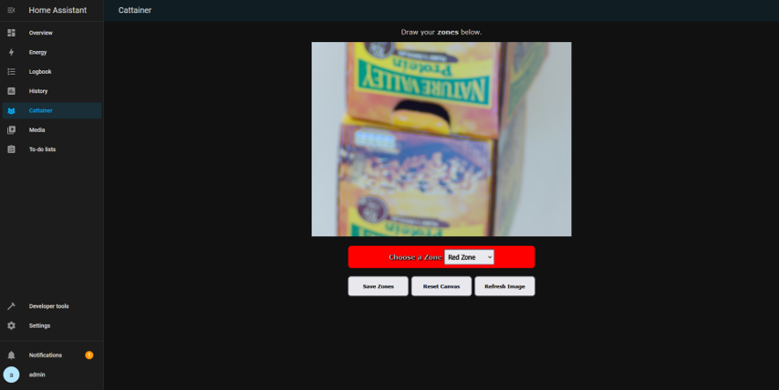
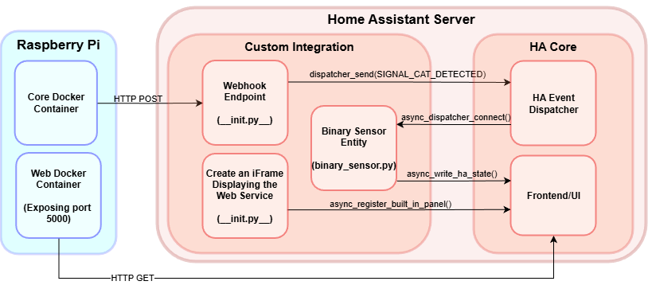

# 🏠🐾 Cattainer — Home Assistant Integration

**A custom Home Assistant integration for [Cattainer](https://github.com/ClemF4/Cattainer) that embeds the interactive Zone Selection Web UI into the Home Assistant sidebar and provides sub-second escape detection alerts via local webhooks[cite: 2, 18, 45, 47, 52, 53].**



## 📖 Overview

`cattainer-integration` bridges your Raspberry Pi-hosted **Cattainer** monitoring system with **Home Assistant**[cite: 8, 45, 53]. Built upon the [integration_blueprint](https://github.com/ludeeus/integration_blueprint) template, it eliminates the need to manage separate browser tabs or polling loops by registering a native sidebar iFrame panel for drawing garden zones and exposing an event-driven `binary_sensor` entity that updates instantaneously whenever your cat enters a forbidden zone or prepares to jump a boundary[cite: 9, 16, 18, 45, 46, 47, 71].

---

## ✨ Features

* **Native Sidebar Zone Editor:** Uses `frontend.async_register_built_in_panel` to add a dedicated **Cattainer** panel (`mdi:cat`) to your Home Assistant sidebar, embedding the Raspberry Pi's port `5000` zone configuration interface directly inside the Home Assistant UI[cite: 45, 46].
* **Sub-Second Webhook Binary Sensor:** Exposes a `cat_detected` binary sensor entity (`binary_sensor.py`) driven by a local HTTP POST webhook endpoint (`/api/webhook/cattainer_incoming_data`), providing instant state transitions (`on` / `off`) for Home Assistant automations and mobile push notifications[cite: 18, 45, 47, 52].
* **UI Config Flow Setup:** Configured entirely through the Home Assistant GUI (`config_flow.py`) by entering your Cattainer device's local IP address—no manual `configuration.yaml` editing required[cite: 9, 46].
* **Asynchronous Event Dispatcher:** Uses Home Assistant's internal event dispatcher (`dispatcher_send` and `async_dispatcher_connect`) to route incoming webhook payloads directly to the binary sensor entity without blocking the Home Assistant core loop[cite: 45, 46, 47].

---

## 🏗️ Integration Architecture



The integration communicates with the Raspberry Pi running Cattainer over the local network via two pathways[cite: 45]:
1. **Control Plane (`HTTP GET` on Port `5000`):** During setup in `__init__.py`, the integration registers an iFrame panel pointing to `http://<CATTAINER_PI_IP>:5000`, allowing users to view camera snapshots and draw Red/Amber polygon zones directly from Home Assistant[cite: 45, 46].
2. **Alert Plane (`HTTP POST` on Port `8123`):** When Cattainer's Core container detects a zone breach, it sends a JSON payload (`{"cat_detected": true}`) to `http://<HA_IP_ADDRESS>:8123/api/webhook/cattainer_incoming_data`[cite: 45, 47]. The `handle_webhook` endpoint in `__init__.py` catches the POST request and fires `SIGNAL_CAT_DETECTED` through the Home Assistant Event Dispatcher to `binary_sensor.py`, which immediately calls `async_write_ha_state()` to update the frontend UI and trigger automations[cite: 45, 47].

---

## 📦 Installation

### Option 1: HACS (Custom Repository)
1. Open **HACS** in your Home Assistant instance[cite: 9].
2. Click the three dots in the top-right corner and select **Custom repositories**.
3. Enter `https://github.com/ClemF4/cattainer-integration` as the repository URL and select **Integration** as the category[cite: 53].
4. Download the **Cattainer** integration and restart Home Assistant.

### Option 2: Manual Installation
1. Clone or download this repository[cite: 53]:
   ```bash
   git clone [https://github.com/ClemF4/cattainer-integration.git](https://github.com/ClemF4/cattainer-integration.git)
   ```
  [cite: 53]
2. Copy the `custom_components/cattainer` directory into your Home Assistant configuration folder's `custom_components/` directory.
3. Restart Home Assistant.

---

## ⚙️ Configuration

1. Ensure the [Cattainer Docker stack](https://github.com/ClemF4/Cattainer) is running on your Raspberry Pi (`docker compose up -d`) and note its local IP address[cite: 14, 18, 44, 46].
2. In Home Assistant, go to **Settings** $\rightarrow$ **Devices & Services** $\rightarrow$ **Add Integration**.
3. Search for **Cattainer** and select it[cite: 46].
4. When prompted by the configuration flow, enter your credentials and the **IP Address** of your Cattainer Raspberry Pi (e.g., `192.168.1.91`)[cite: 25, 46].
5. A **Cattainer** tab with a cat icon (`mdi:cat`) will immediately appear in your Home Assistant sidebar, and the `cat_detected` binary sensor entity will be registered[cite: 18, 46].

---

## 🧪 Testing the Webhook & Creating Automations

### Manual Webhook Verification
You can test that the integration's webhook listener and binary sensor state updates are working properly before deploying the camera outdoors by running the following `curl` commands from a terminal[cite: 47]:

**Simulate Cat Escape Detection (`on`)[cite: 47]:**
```bash
curl -X POST \
  -H "Content-Type: application/json" \
  -d '{"cat_detected": true}' \
  http://<HA_IP_ADDRESS>:8123/api/webhook/cattainer_incoming_data
```
[cite: 47]

**Simulate Deterrent Reset (`off`)[cite: 47]:**
```bash
curl -X POST \
  -H "Content-Type: application/json" \
  -d '{"cat_detected": false}' \
  http://<HA_IP_ADDRESS>:8123/api/webhook/cattainer_incoming_data
```
[cite: 47]

| Test Case | Simulated Payload | Expected State |
| :--- | :--- | :--- |
| **Valid Detection** | `{"cat_detected": true}` | Changes to `on`[cite: 47] |
| **Valid Reset** | `{"cat_detected": false}` | Changes to `off`[cite: 47] |
| **Corrupt Data** | `{}` (Empty Payload) | Defaults to `off`[cite: 47] |

### Example Notification Automation
Once configured, you can create an automation in Home Assistant (**Settings** $\rightarrow$ **Automations & Scenes**) that triggers whenever the binary sensor turns `on` to send an instant alert to your phone[cite: 18, 47]:

```yaml
alias: "Cattainer: Cat Escape Alert"
description: "Send an instant notification when a cat enters a Red Zone or jumps in an Amber Zone"
trigger:
  - platform: state
    entity_id: binary_sensor.cat_detected
    from: "off"
    to: "on"
action:
  - action: notify.mobile_app_your_phone
    data:
      title: "🐾 Cat Boundary Alert!"
      message: "Your cat was detected in a restricted zone or preparing to jump the fence!"
mode: single
```

---

## 🎓 Credits & Acknowledgements

* Developed by **Clement Faure** as part of the MEng Final Year Individual Project (*EEEE4008: Development of a Cat Monitoring System*) at the **University of Nottingham**[cite: 1].
* Built upon the [ludeeus/integration_blueprint](https://github.com/ludeeus/integration_blueprint) template by Joakim Sørensen[cite: 9, 63, 71].